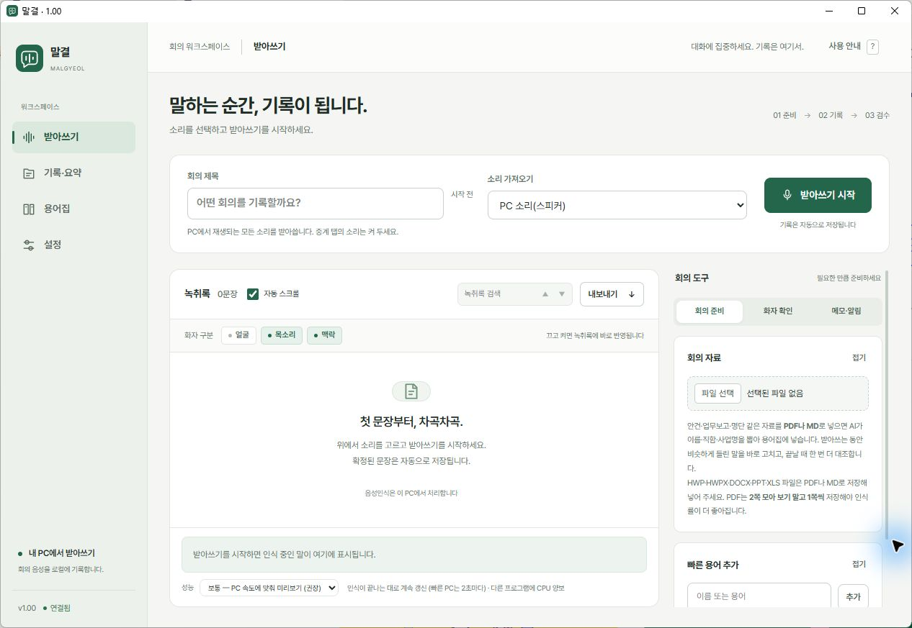

# 말결 · MALGYEOL
대화를 기록으로 잇다.

Windows에서 회의 소리(PC 소리·마이크·녹음 파일)를 받아 적고 녹취록을 검수·요약해 공유하거나 노트로 남기는 개인용 앱입니다.

> **Windows 전용입니다.** Windows 11에서 설치·실행을 확인했으며, macOS·Linux 설치 파일은 없습니다.



## 다운로드와 설치

[말결 설치 파일 받기](https://github.com/worlyung/malgyeol/releases/latest)

1. 릴리스의 **Malgyeol-1.08-Setup.exe**를 다운로드합니다(약 0.2GB).
2. 설치 EXE를 실행하고 설치할 폴더를 고릅니다.
3. 설치가 끝나면 **실행**을 누르거나 바탕화면의 **말결** 바로가기를 엽니다.
4. **설정 → 음성인식**에 [Soniox](https://soniox.com) API 키를 넣습니다. 인터넷 없이 쓰려면 같은 화면에서 **PC 위스퍼 설치**를 누릅니다.

Windows 전용입니다(Windows 11에서 확인). Python 실행기가 들어 있어 따로 Python을 설치하지 않아도 됩니다. 파일 크기와 SHA-256은 릴리스 첨부 파일을 참고하세요.

기존 설치를 갱신할 때는 **먼저 말결을 완전히 닫고** 설치 파일을 실행한 뒤 같은 폴더를 고르고 **프로그램만 새로 덮어쓰기**를 선택하세요. 기록과 설정, 이미 받아 둔 PC 위스퍼는 그대로 남습니다. **전부 새로 설치**는 기록과 설정을 지웁니다. 새 버전이 나오면 말결 화면 위쪽에 알림이 뜹니다.

## 사용 순서

1. **받아쓰기**에서 회의 제목과 소리를 정하고 **받아쓰기 시작**을 누릅니다. 녹음 파일은 바로 아래 **녹음 파일 넣기**로 고릅니다.
2. 끝나면 **기록·요약**에서 녹음을 들으며 문장을 검수합니다.
3. AI 요약을 만들고 **공유**로 카톡·텔레그램·메일에 보내거나 **노트로 저장**합니다.

| 화면 | 주요 기능 |
|---|---|
| 받아쓰기 | PC 소리·마이크·녹음 파일·영상 주소 받아쓰기, 실시간 미리보기, 화자 구분, 자막 창 |
| 기록·요약 | 기록 검색, 폴더 정리, 문장 편집, 녹음 재생, 화자 다시 나누기, AI 요약, 외부 AI용 프롬프트, 내보내기, 공유 |
| 용어집 | 이름·기관명·전문 용어 등록과 교정 |
| 설정 | AI 연결, 음성인식(Soniox·PC 위스퍼), 화자·교정, 등록된 사람, 화면, 노트 저장 |

## 주요 기능

### 받아쓰기: Soniox와 PC 위스퍼

| | Soniox (기본) | PC 위스퍼 (선택 설치) |
|---|---|---|
| 장점 | 빠르고 정확합니다. 고유명사·사투리에 강하고 문장 부호가 붙습니다. 설치하자마자 쓸 수 있습니다. | 소리가 이 PC 밖으로 나가지 않습니다. 인터넷 없이 됩니다. |
| 준비 | Soniox API 키 | **설정 → 음성인식 → PC 위스퍼 설치**(약 3GB) |
| 요금 | 1시간에 약 0.12달러(Soniox 계정에 청구) | 없음 |

- 회의 중에는 소리를 실시간으로 보내고 녹음 파일은 한 번에 보냅니다(45분짜리가 1분 안쪽). 원본 파일(m4a 등)이 더 작으면 원본을 그대로 보냅니다.
- 소리가 한동안 없거나 인터넷이 잠깐 끊겨도 연결을 이어 가며 끊기면 저절로 다시 연결합니다.
- Soniox 키가 없고 PC 위스퍼가 설치되어 있으면 PC 위스퍼로 받아씁니다.

### 화자 구분

- 받아쓰는 동안에는 말결이 목소리·얼굴·맥락(자기소개, 사회자의 지명)으로 화자를 정합니다.
- 일레븐랩스 키를 넣지 않았다면 녹음 파일을 받아쓸 때 Soniox가 화자까지 함께 나눕니다.
- **화자 다시 나누기**(선택): [일레븐랩스](https://elevenlabs.io/speech-to-text-api) API 키를 **설정 → 화자·교정**에 넣으면 끝난 회의의 화자를 다시 나눕니다. 같은 45분 회의를 사람이 고친 녹취록과 대조했을 때 일레븐랩스 98.3%, Soniox 90.0%가 맞아 이 단추는 일레븐랩스를 씁니다. 받아쓴 글자는 그대로 두고 화자만 다시 붙이며 나누기 전 녹취록은 `transcript.before-elevenlabs.json`으로 남습니다.

### AI 요약과 AI 연결

- **설정 → AI 연결**에서 로그인된 Claude Code·Codex 또는 API 키(Gemini·Anthropic·OpenAI·네이버 Clova Studio)를 고릅니다.
- 연결 상태가 "✅ 연결됨"으로 표시되고 **연결 시험**을 누르면 실제로 답이 오는지 확인합니다.
- 모델은 목록에서 고르거나 직접 입력합니다. Codex와 API 키 제공자는 그때그때 최신 목록을 받아 옵니다.
- AI 연결 없이도 **외부 AI용 프롬프트**를 복사해 ChatGPT·Claude·Gemini 등에 직접 붙여넣을 수 있습니다.

### 공유

기록·요약에서 회의를 고르고 **공유**를 누릅니다. 보내기는 직접 합니다. 말결은 붙여넣을 글과 끌어다 놓을 파일만 준비합니다.

- **요약 복사 / 녹취록 전체 복사**: 카톡·텔레그램에 붙여넣기 좋은 글로 복사합니다.
- **파일로 보내기**: 녹취록(과 요약) Word 파일을 `문서\말결 공유`에 만들고 폴더를 엽니다.
- **메일로 보내기**: 메일 제목·본문을 복사하고 첨부할 파일 폴더를 엽니다.
- **노트로 저장**: 아래 노트 저장 폴더에 회의록 노트를 씁니다.

### 회의록 노트 저장 (선택)

**설정 → 노트 저장**에서 켜고 폴더를 고르면 회의가 끝날 때 `회의록_제목_날짜.md`로 저장합니다. 옵시디언을 쓰면 볼트 안의 폴더를, 아니면 아무 폴더나 고르세요.

- 노트 맨 위에 종류·날짜·출처·참석자·태그가 붙어 옵시디언 검색과 Bases에서 회의록으로 찾을 수 있습니다.
- AI 요약·메모 반영·화자 다시 나누기가 끝나면 같은 노트를 새로 씁니다. 노트를 직접 고쳤다면 덮어쓰지 않습니다.

### 노트북 한 대로 쓸 때

- **간결 보기**: 창이 작으면 저절로 켜집니다. 왼쪽 메뉴를 아이콘만 남기고 받아쓰는 동안 준비 칸과 회의 도구를 접어 녹취록을 크게 보여 줍니다.
- **자막 창**: 위쪽 **자막 창**을 누르면 작은 창으로 줄어 다른 창 위에 떠 있고 최근 세 문장과 지금 하는 말만 보여 줍니다. 화상회의를 하면서 받아쓸 때 쓰세요.
- **화면 색**: **설정 → 화면**에서 컴퓨터 설정 따르기·밝게·어둡게(다크 모드)를 고릅니다.

## 데이터가 나가는 곳

- **Soniox로 받아쓰면** 회의 소리가 Soniox 서버로 갑니다. 녹음 파일은 받아쓰기가 끝나면 Soniox 서버에서 바로 지웁니다. 녹음을 밖으로 보내면 안 되는 회의는 PC 위스퍼를 쓰세요.
- **화자 다시 나누기**는 누른 회의의 녹음 파일 전체를 일레븐랩스로 보냅니다.
- **AI 요약**과 일부 맥락 화자 판별은 연결한 AI에 녹취록 텍스트를 보냅니다.
- 얼굴·목소리 비교, 기록·설정 저장은 이 PC에서 합니다. 기록·설정은 설치 폴더의 `data`에, API 키는 `data/.env`에만 저장합니다.
- 공개 설치본에는 개인 기록·명부·용어집·얼굴/목소리 특징·API 키를 넣지 않습니다.

## 사용 시 참고

- 중요한 기록은 녹음과 대조해 검수하세요. 소리 상태에 따라 정확도가 달라집니다.
- 창을 닫으면 기록을 마무리한 뒤 종료합니다. 종료 중에는 강제로 끄지 마세요.
- 한 PC에서 쓰는 앱이며 여러 사람이 함께 쓰는 서버로 만들지 않았습니다.

## 업데이트 내역

### 1.08 (2026-11-27)
- **AI 연결 상태 표시와 연결 시험**: 연결되면 "✅ 연결됨 — 제공자 · 모델"로 보여 주고 **연결 시험**으로 실제 응답을 확인합니다.
- **모델 고르기**: 목록에서 고르거나 직접 입력합니다. Codex와 API 키 제공자는 최신 목록을 받아 옵니다.

### 1.07 (2026-11-27)
- **회의록 노트 저장(선택)**: 회의가 끝나면 옵시디언 볼트나 아무 폴더에 `회의록_제목_날짜.md`로 저장합니다. 직접 고친 노트는 덮어쓰지 않습니다.
- **공유 → 노트로 저장**: 지난 회의도 노트로 저장합니다.

### 1.06 (2026-11-23)
- **소리가 20초 넘게 없으면 받아쓰기가 멈추던 문제를 고쳤습니다.** 연결이 끊기면 저절로 다시 잇습니다.
- **녹음 파일 넣기** 단추, **간결 보기**, **자막 창**, **화면 색(다크 모드)**.
- 녹음 파일은 원본이 더 작으면 원본을 그대로 보냅니다.

### 1.05 (2026-11-23)
- **공유 메뉴**: 요약·녹취록 복사(카톡·텔레그램), Word 파일로 보내기, 메일로 보내기.

### 1.04 (2026-11-20)
- 일레븐랩스 키가 없으면 녹음 파일을 받아쓸 때 Soniox가 화자까지 나눕니다.
- 설정 → 음성인식에 Soniox와 PC 위스퍼 설명을 넣었습니다.

### 1.03 (2026-11-20)
- **받아쓰기 기본을 Soniox로** 바꿨습니다. PC 위스퍼는 필요할 때만 설치합니다.
- 설치 파일이 1.9GB에서 약 0.2GB로 줄었습니다.
- 1.02에서 준비한 외부 AI용 요약 프롬프트가 함께 들어갔습니다.

### 1.02 (공개하지 않음)
- **외부 AI용 요약 프롬프트**: AI 연결 없이 회의 정보·녹취록이 담긴 요청문을 복사하거나 TXT로 받습니다.

### 1.01 (2026-10-29)
- **회의 폴더 옮기기**, **화자 다시 나누기**(일레븐랩스), 설정에 일레븐랩스 API 키 칸.

### 1.00 (2026-10-27)
- 새 이름 말결(MALGYEOL)과 로고, 받아쓰기·기록·요약·용어집·설정 화면 개편, Windows 설치 파일 배포.

버전마다 자세한 내용은 [docs의 릴리스 노트](docs)에 있습니다(`release-notes-v1.xx.md`).

## 개발과 검증

소스 실행에는 Python과 `requirements.txt`의 의존성이 필요합니다.

```powershell
python -m pip install -r requirements.txt
python -m app.gui
python -m unittest discover -s tests -p "test_*.py"
```

설치 파일은 `python -m scripts.build_exe --no-roster`로 만듭니다. PC 위스퍼 모델과 그래픽카드 부품까지 넣은 예전 전체판은 `--with-whisper`를 붙입니다.

- [설치 파일 제작과 배포](docs/말결-1.00-배포.md)
- [설치·실행 검증 기록](docs/release-verification.json)
- [UI·UX 개편 내역](docs/UI-UX-개편-보고서.md)
- [브랜드 자산](docs/말결-브랜드.md)

## 원본과 라이선스

충청남도 박소영님의 [LiveCaption](https://gitlab.aigov.go.kr/soyoung776/livecaption)을 바탕으로 이름·화면·사용 흐름과 Windows 배포를 개편했습니다.

코드는 [MIT 라이선스](LICENSE)로 제공하며 원저작권 표시를 유지합니다. 포함된 외부 패키지와 모델에는 각각의 라이선스가 적용됩니다.
