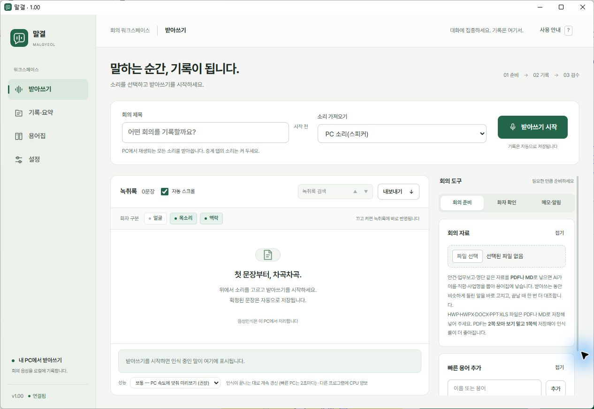

# 말결 · MALGYEOL
대화를 기록으로 잇다.

Windows에서 PC 소리·마이크·음성 파일을 받아 적고, 녹취록을 검수하고 정리하는 개인용 앱입니다.



## 다운로드와 설치

[말결 1.01 설치 파일 받기](https://github.com/worlyung/malgyeol/releases/latest)

1. 릴리스의 **Malgyeol-1.01-Setup.exe**를 다운로드합니다.
2. 설치 EXE를 실행하고 설치할 폴더를 선택합니다.
3. 설치가 끝나면 **실행**을 누르거나 바탕화면의 **말결** 바로가기를 엽니다.

Windows 11에서 설치·실행을 확인했습니다. Python 실행기와 음성인식 모델을 포함하므로 별도 Python 설치가 필요하지 않습니다. 파일 크기와 SHA-256은 릴리스 첨부 파일을 참고하세요.

기존 설치를 갱신할 때는 같은 폴더를 선택하고 **프로그램만 새로 덮어쓰기**를 고르세요. **전부 새로 설치**는 기록과 설정을 지웁니다.

## 사용 순서

1. **받아쓰기**에서 회의 제목과 소리 입력을 정하고 시작합니다.
2. 기록이 끝나면 **기록·요약**에서 녹음을 들으며 문장을 검수합니다.
3. 필요하면 AI 요약을 만들고 내보내기 메뉴로 저장합니다.

| 화면 | 주요 기능 |
|---|---|
| 받아쓰기 | PC 소리·마이크·파일 입력, 실시간 녹취, 화자 구분 |
| 기록·요약 | 기록 검색, 폴더 정리(클릭·끌어다 놓기), 문장 편집, 녹음 재생, 화자 다시 나누기, AI 요약 |
| 용어집 | 이름·기관명·전문 용어 등록과 교정 |
| 설정 | 음성인식 성능, 화자 구분, 일레븐랩스 키, AI 연결 |

TXT·DOCX·SRT·Markdown·JSON 등 화면의 내보내기 메뉴를 사용합니다. 제공 형식은 기록 종류에 따라 다릅니다.

### 회의를 폴더로 정리하기

**기록·요약**의 회의 목록에서 회의 옆 **폴더** 버튼을 누르고 옮길 폴더를 고릅니다. 회의를 끌어다 위쪽 폴더 이름에 놓아도 됩니다. **전체 회의**에 놓으면 폴더에서 뺍니다.

### 화자 다시 나누기 (선택)

여럿이 빠르게 주고받는 대화는 이 PC의 목소리 구분만으로는 사람이 섞이거나 지나치게 잘게 나뉠 수 있습니다. 이럴 때 일레븐랩스를 연결하면 끝난 회의의 화자를 다시 나눌 수 있습니다.

1. [일레븐랩스](https://elevenlabs.io/speech-to-text-api)에서 API 키를 만들고 **설정 → 화자 구분 → 일레븐랩스 API 키**에 넣습니다.
2. **기록·요약**에서 회의를 열고 **화자 다시 나누기**를 누릅니다.

말결이 받아쓴 글자(용어집 교정·직접 고친 내용 포함)는 그대로 두고, 사람이 바뀌는 지점에서 문장을 나눠 화자만 다시 붙입니다. 나누기 전 녹취록은 회의 폴더에 `transcript.before-elevenlabs.json`으로 남습니다.

## AI 연결과 데이터

- 음성인식과 얼굴·목소리 비교는 이 PC에서 처리합니다.
- AI 요약과 일부 맥락 기반 화자 판별은 연결한 외부 AI에 텍스트를 전송합니다. 민감한 회의는 전송 범위를 확인한 뒤 사용하세요.
- **화자 다시 나누기**는 누른 회의의 **녹음 파일 전체**를 일레븐랩스 서버로 전송합니다. 이용 요금은 일레븐랩스 계정에 청구됩니다. 키를 넣지 않으면 녹음은 밖으로 나가지 않습니다.
- 설정에서 로그인된 Claude Code/Codex 또는 지원하는 API 연결을 선택합니다. 이용 요금은 연결한 서비스에 따릅니다.
- 기록·설정은 설치 폴더의 `data`에 저장합니다. API 키는 `data/.env`에 저장합니다.
- 공개 설치본에는 개인 기록·명부·용어집·얼굴/목소리 특징·API 키를 넣지 않습니다.

## 사용 시 참고

- 중요한 기록은 녹음과 대조해 검수하세요. 소리 상태와 PC 성능에 따라 정확도와 속도가 달라집니다.
- 창을 닫으면 기록을 마무리한 뒤 종료합니다. 종료 중에는 강제로 끄지 마세요.
- 한 PC에서 사용하는 앱이며, 여러 사용자가 공유하는 서버 서비스로 구성되어 있지 않습니다.

## 업데이트 내역

### 1.01 (2026-10-29)

- **회의 폴더 옮기기**: 회의 목록의 **폴더** 버튼으로 클릭 두 번에 옮기고, 끌어다 놓기로도 옮길 수 있습니다.
- **화자 다시 나누기**: 일레븐랩스로 끝난 회의의 화자를 다시 나눕니다. 45분 실제 회의 녹음에서 목소리 구분 결과 36명이 3명으로 정리되는 것을 확인했습니다.
- **설정에 일레븐랩스 API 키 칸 추가**: 키는 `data/.env`에만 저장하고 화면에는 가려서 보여 줍니다.

### 1.00 (2026-10-27)

- 새 이름 말결(MALGYEOL)과 로고, 받아쓰기·기록·요약·용어집·설정 화면 개편, Windows 설치 파일 배포.

자세한 내용은 [릴리스 노트](docs/release-notes-v1.01.md)를 참고하세요.

## 개발과 검증

소스 실행에는 Python과 `requirements.txt`의 의존성이 필요합니다.

```powershell
python -m pip install -r requirements.txt
python -m app.gui
python -m unittest discover -s tests -p "test_*.py"
```

- [설치 파일 제작과 배포](docs/말결-1.00-배포.md)
- [설치·실행 검증 기록](docs/release-verification.json)
- [UI·UX 개편 내역](docs/UI-UX-개편-보고서.md)
- [브랜드 자산](docs/말결-브랜드.md)

## 원본과 라이선스

충청남도 박소영님의 [LiveCaption](https://gitlab.aigov.go.kr/soyoung776/livecaption)을 바탕으로 이름·화면·사용 흐름과 Windows 배포를 개편했습니다.

코드는 [MIT 라이선스](LICENSE)로 제공하며 원저작권 표시를 유지합니다. 포함된 외부 패키지와 모델에는 각각의 라이선스가 적용됩니다.
